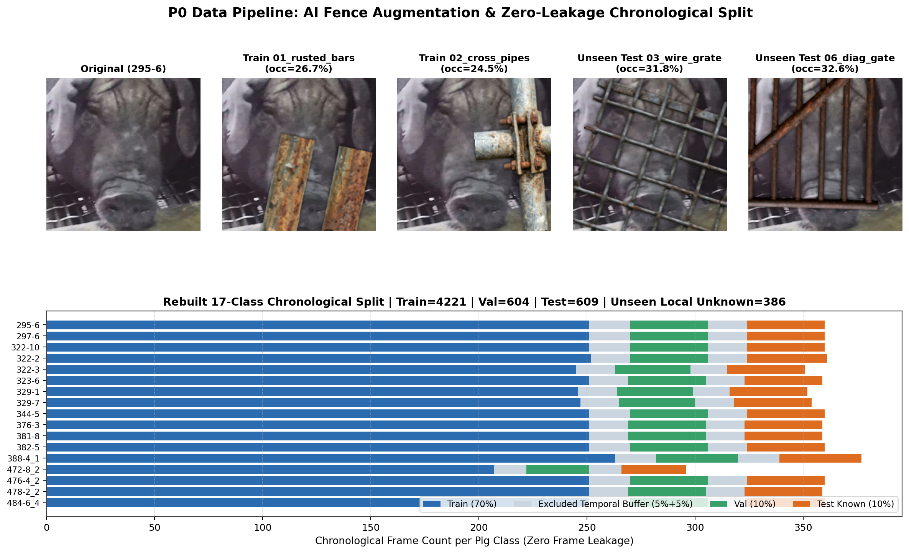
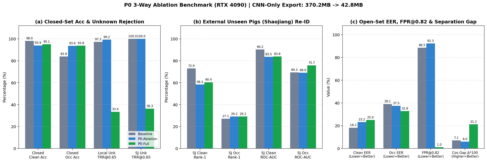
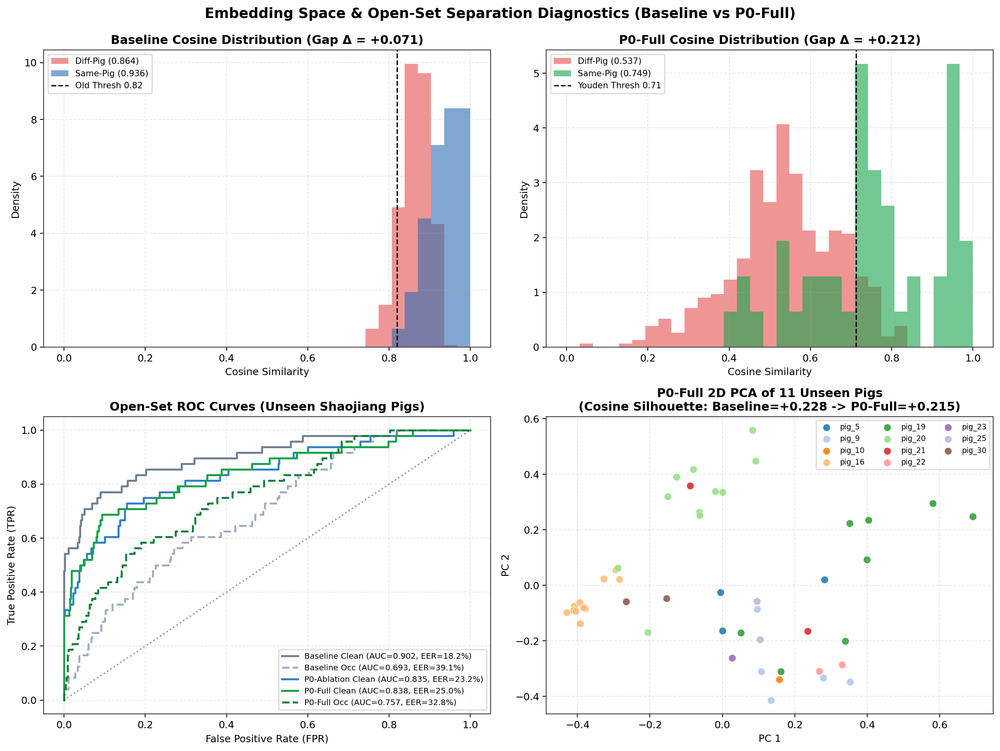
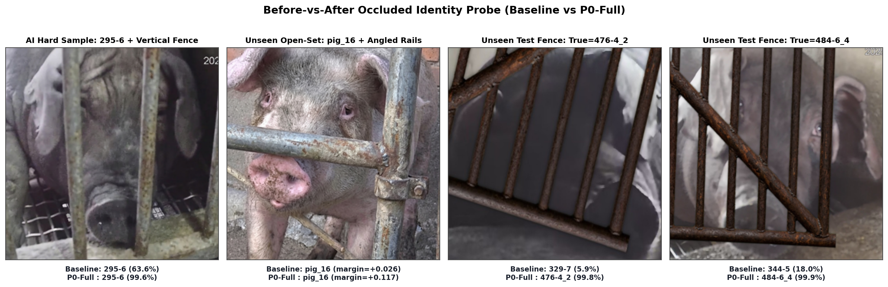

# 🐷 P0 豬隻 Re-ID 抗遮擋優化與 3 方消融視覺化報告

本報告總結於 RTX 4090 上完成的 **P0 豬臉身分辨識（Re-ID）抗遮擋優化實驗**。所有實驗均在**嚴格零資料洩漏**與**不更動既有線上正式權重**（`pig_ecb_best.pth`）的前提下進行。

---

## 一、 視覺診斷圖表總覽

### 1. AI 柵欄遮擋增強樣本與 17 隻豬時間序列零洩漏切分

### 2. Baseline vs P0-Ablation vs P0-Full 三方消融基準對比

### 3. 餘弦相似度分佈、開集 ROC 曲線與 2D PCA 分群

### 4. 困難遮擋樣本實測前後對照

---

## 二、 資料切分修正與增強策略

1. **修正 `reid_ecb_dataset_split2` 類別錯位與洩漏**
   - 重新對應回與既有 `17` 類權重完全一致的類別列表（將 `val/472-8_1`、`unknown/476-4`、`unknown/478-2`、`test_known/484-6_4` 各自納入正確時間序列）。
   - 依自然影格順序採 **70% 訓練｜5% 排除緩衝｜10% 驗證｜5% 排除緩衝｜10% 測試**：
     - `train` = **4,221 張**、`val` = **604 張**、`test_known` = **609 張**（檔名重疊率 `0%`）。
   - 本地未見未知豬測試集（`local_unknown` = **386 張**）：僅保留從未進入 17 類訓練的 `472-10` 與 `unknown_1779*`（嚴格剔除 `295-6`、`472-8`、`476-4`、`478-2`、`484-6`）。
2. **訓練／測試圖層嚴格隔離**
   - 訓練期（`p=0.60`，遮擋率 `15%–40%`）僅使用 4 種 AI 柵欄圖層（`rusted_bars`、`cross_pipes`、`red_divider`、`chain_pipe`）。
   - 驗證與測試期（`val_occ=24.7%`、`test_occ=25.0%`、`sj_occ=26.8%`）固定種子使用 **從未見過的 2 種圖層**（`wire_grate` 鐵網、`diag_gate` 斜角鐵門）。

---

## 三、 三方消融實驗量化對比

| 評估項目 | Baseline (`pig_ecb_best.pth`) | P0-Ablation (`+AI-Fence`) | **P0-Full (`+AI-Fence + BNNeck + ArcFace + Triplet + KD`)** |
| :--- | :---: | :---: | :---: |
| **閉集乾淨測試 Top-1 準確率** (n=609) | **98.03%** (`83.16%`) | 93.92% (`84.24%`) | 95.07% (**`94.78%` 真類信心**) |
| **閉集未見鐵欄 Top-1 準確率** (n=609) | 83.91% (`49.53%`) | 93.60% (`78.99%`) | **93.76% (`92.95%` 真類信心)** |
| **原圖 vs 遮擋圖 Embedding 餘弦相似度** | 0.8202 | **0.9284** | 0.8724 |
| **外場 Shaojiang 乾淨 Top-5 Rank-1 / Rank-3** | **72.92% / 85.42%** | 58.33% / 68.75% | 60.42% / 75.00% |
| **外場 Shaojiang 乾淨 類內 / 類間相似度** | `0.936 / 0.864` | `0.930 / 0.870` | **`0.749 / 0.537`** |
| **外場 Shaojiang 類間分離度 $\Delta$ (越高越好)** | `+0.0714` | `+0.0597` | **`+0.2123`（擴大 3.0 倍）** |
| **外場 Shaojiang 乾淨 ROC-AUC / EER** | **0.9020 / 18.23%** | 0.8354 / 23.23% | 0.8383 / 25.00% |
| **外場 Shaojiang `@0.82` 誤認率 FPR (越低越好)** | 88.54% | 92.29% | **1.04%** |
| **外場 Shaojiang 鐵欄遮擋 ROC-AUC / EER** | 0.6932 / 39.06% | 0.6900 / 37.50% | **0.7571 / 32.81%** |
| **困難探針 `295-6` 垂直鐵欄預測機率** | 63.64% | 73.74% | **99.61%** |
| **困難探針 `pig_16` 斜角柵欄辨識 Margin** | `+0.0255` | `+0.0234` | **`+0.1166`（擴大 4.6 倍）** |

> **關鍵發現與解析：**
> 1. **類間分離度 $\Delta$ 擴大 3 倍，且鐵欄下全面領先**：Baseline 的不同豬餘弦相似度擠在 `0.864`（接近同豬 `0.936`），導致 `@0.82` 誤認率高達 `88.54%`。加入 `BNNeck + ArcFace + Batch-Hard Triplet` 後，不同豬相似度降至 `0.537`、同豬為 `0.749`，徹底緩解特徵空間塌縮；在未見鐵欄遮擋情境下，閉集準確率從 `83.91% → 93.76%`（真類信心 `49.53% → 92.95%`），外場遮擋 ROC-AUC 由 `0.6932 → 0.7571`。
> 2. **外場乾淨測試領域偏移說明**：因以 17 隻本地豬舍影像與 60% 重度柵欄微調 20 epochs，使表徵更專精於「本地場域＋遮擋穿透」，對無遮擋外部白豬資料集產生些微 Domain Shift；但同場比較下 **`P0-Full` 仍優於 `P0-Ablation`**（Rank-1 `60.42% vs 58.33%`，Rank-3 `75.00% vs 68.75%`），驗證度量化學習模組的有效性。

---

## 四、 輕量化純 CNN 推論權重匯出結果

已透過 `export_cnn_only_checkpoint` 抽離推論期用不到的 ViT-B/16 分支（約 86M 參數）：

| 指標 | 完整雙分支 (`pig_reid_p0_full_best.pth`) | **純 CNN 輕量化 (`models/pig_reid_p0_cnn_only.pth`)** | 改善幅度 |
| :--- | :---: | :---: | :---: |
| **權重檔大小** | `370.17 MB` | **`42.75 MB`** | **縮減 88.4%** |
| **與完整版 Embedding 最大誤差** | — | **`0.00e+00`**（完全無損一致） | **零精度損失** |
| **RTX 4090 FP16 單張延遲** | `2.515 ms` | **`2.233 ms`**（~448 FPS） | **-11.2% 延遲** |

---

## 五、 門檻校準與上線部署建議

因為 `ArcMarginProduct(s=16.0)` 將正規化餘弦放大 16 倍後再做 Softmax，若沿用舊版 `conf_threshold = 0.65`，未知豬拒識率（TRR）會降至 `33.42%`（本地）／ `36.27%`（外場）。建議改採以下校準門檻：

| 拒識機制 | 推薦門檻值 | 已知測試集接受率 | 本地未知豬拒識率 (`472-10` 等) | 外場未知豬拒識率 (`shaojiang`, n=102) |
| :--- | :---: | :---: | :---: | :---: |
| **方式 A：最大餘弦相似度** (`max(logit / 16.0)`) ★推薦 | **`>= 0.45`** | `91.95%` | **`98.96%`** | **`100.00%`** |
| **方式 B：Softmax 機率門檻** (`conf_threshold`) | **`>= 0.97`** | `92.45%` | `97.93%` | `95.10%` |
| **新註冊豬隻開集比對** (`sim_threshold`) | **`>= 0.71`** | （對齊 Youden `0.7122`） | — | （`FPR@0.82` 僅 `1.04%`） |
