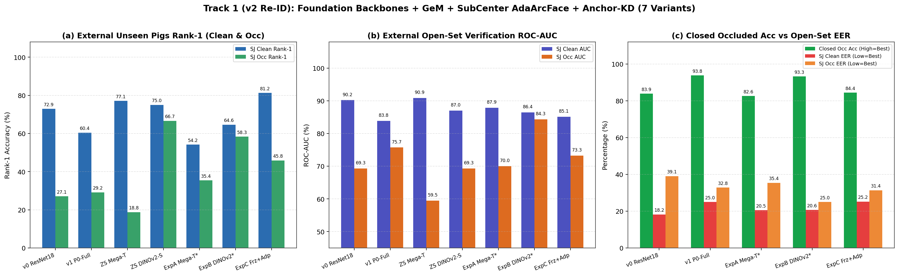
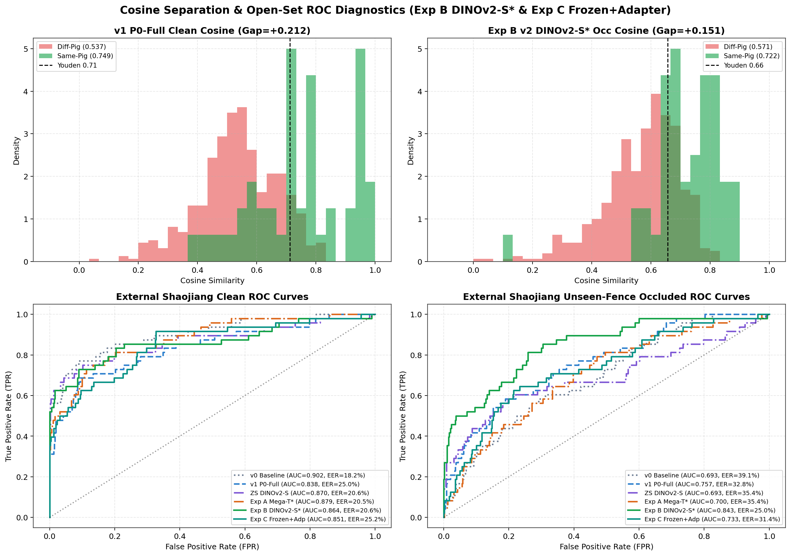
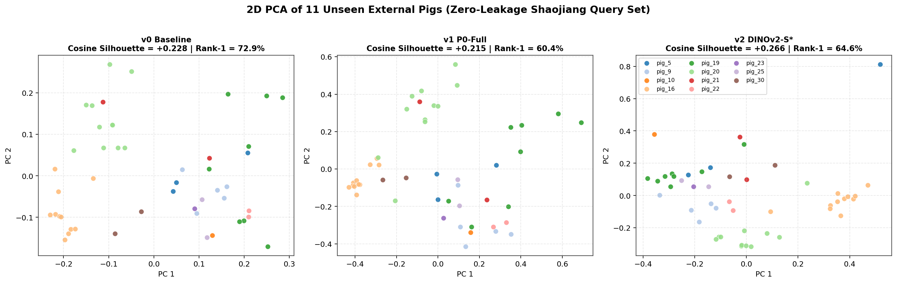
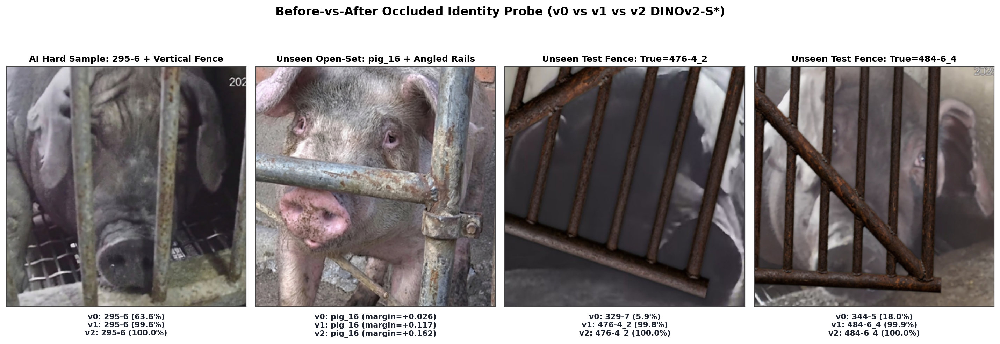

# Track 1 (`v2`): Occlusion-Aware Foundation Pig Re-ID

This branch upgrades Pig Re-ID from ResNet18 (`v0`/`v1`) to a self-supervised **DINOv2-ViT-S/14** backbone with **GeM Token Pooling**, **Sub-Center (K=3) AdaFace-ArcFace** quality-adaptive margins, **Batch-Hard Triplet**, and **Relational Anchor-KD** across zero-shot and fine-tuned experiments.

## Key Verified Results (Zero-Leakage Benchmarks)

| Metric | `v0` ResNet18 | `v1` P0-Full | ZS `MegaDescriptor-T` | ZS `DINOv2-S/14` | Exp A `Mega-T*` | **Exp B `DINOv2-S*` (Winner)** | Exp C `Frozen+Adapter` |
| :--- | :---: | :---: | :---: | :---: | :---: | :---: | :---: |
| Closed Clean Acc | 98.03% | 95.07% | 86.21% | 91.95% | 93.76% | **94.09%** | 93.27% |
| Closed Unseen-Fence Acc | 83.91% | 93.76% | 28.74% | 46.96% | 82.59% | **93.27%** | 84.40% |
| Shaojiang Clean Top-5 Rank-1 | 72.92% | 60.42% | 77.08% | 75.00% | 54.17% | 64.58% | **81.25%** |
| Shaojiang Occluded Top-5 Rank-1 | 27.08% | 29.17% | 18.75% | **66.67%** | 35.42% | **58.33%** | 45.83% |
| Shaojiang Occluded ROC-AUC | 0.6932 | 0.7571 | 0.5948 | 0.6931 | 0.7001 | **0.8432** | 0.7325 |
| Shaojiang Occluded EER (lower=better) | 39.06% | 32.81% | 43.75% | 35.42% | 35.42% | **25.00%** | 31.35% |
| Hard Probe `295-6` Vertical Fence | 63.64% | 99.61% | n/a | n/a | 99.51% | **99.99%** | 94.97% |
| Hard Probe `pig_16` Cosine Margin | +0.0255 | +0.1166 | +0.1250 | +0.0809 | +0.1356 | **+0.1615** | +0.0983 |

* Exported FP16 inference weight: `models/pig_reid_v2_dinov2_s_fp16.pth` (**42.11 MB**, **4.36 ms** / image on RTX 4090).

## Diagnostic Figures

