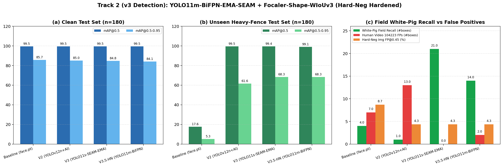
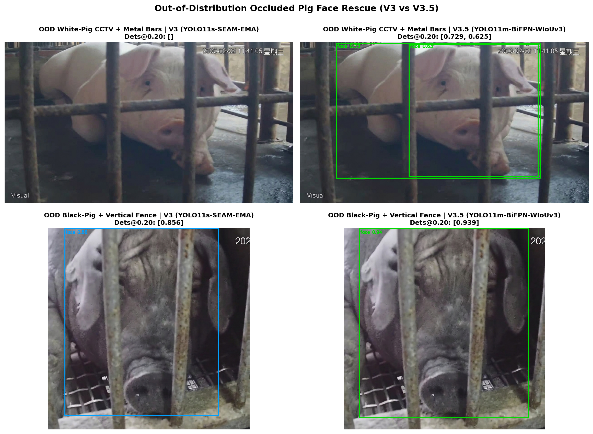
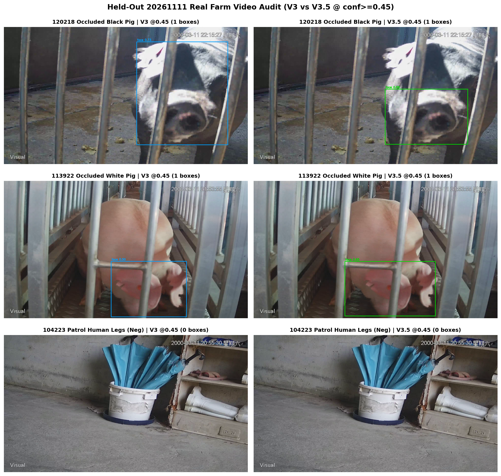

# Track 2 (`v3`): Occluded Multi-Breed Pig Face Detection (`YOLO11m-BiFPN-EMA-SEAM + Focaler-Shape-WIoUv3`)

Built on top of `v2`, this branch scales occluded pig face detection to **YOLO11m** with weighted **BiFPN** multi-scale fusion, **EMA + SEAM** occlusion-aware heads, **Focaler-Shape-WIoUv3** bbox regression, real **20260722 white-pig barn CCTV** frames, and zero-leakage **20261110 + fence-only shortcut-breaker hard-negative hardening (`V3.5-HN`)**.

## Apples-to-Apples Benchmark & Held-Out 20261111 Farm Video Audit

| Metric | Baseline (`face.pt`) | `V2` (`YOLOv12n+AI`) | `V3` (`YOLO11s-SEAM-EMA`) | `V3.5-preHN` | **`V3.5-HN` (Release)** |
| :--- | :---: | :---: | :---: | :---: | :---: |
| Clean Test mAP@0.5 / mAP@0.5:0.95 | 99.50% / 85.74% | 99.50% / 85.04% | 99.50% / 84.79% | 99.49% / 85.94% | **99.50%** / 84.11% |
| Occluded Test mAP@0.5 / mAP@0.5:0.95 | 17.63% / 5.27% | 99.50% / 61.55% | 99.43% / 68.34% | 98.41% / 69.93% | **99.05%** / **68.27%** |
| Hard-Neg Img FP@0.45 | 8.70% | 4.35% | 4.35% | 4.35% | **4.35%** |
| Field `120218` (Black Fence) @0.45 | 16 | 34 | 10 | 28 | **15** |
| Field `113922` / `113613` (White Fence) @0.45 | 2 / 2 | 1 / 0 | 13 / 8 | 4 / 7 | **7 / 7** |
| Field `104223` (Human Patrol Neg) @0.45 | 7 | 13 | 0 | 10 | **2** |
| OOD White Metal Bars (`02_yolo`) | `[0.3568]` | `[0.5601]` | `[]` (Missed) | `[0.5737, 0.4807]` | **`[0.7295, 0.6254]`** |
| OOD Black Vertical Fence (`01_reid`) | `[0.5731]` | `[0.7987]` | `[0.8562]` | `[0.9249]` | **`[0.9389]`** |

* Exported FP16 detection weight: `models/yolo_v35_bifpn_seam_ema_fp16.pt` (**40.69 MB**).

## Diagnostic Figures

